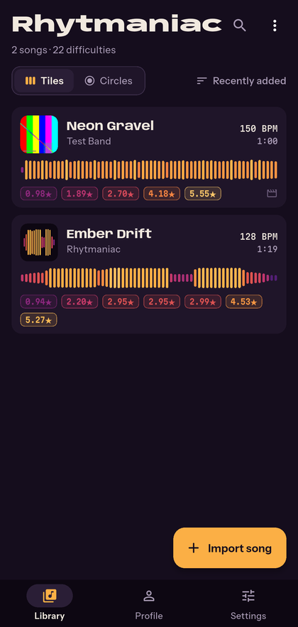
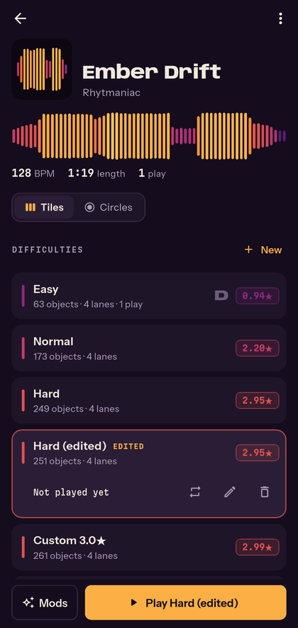
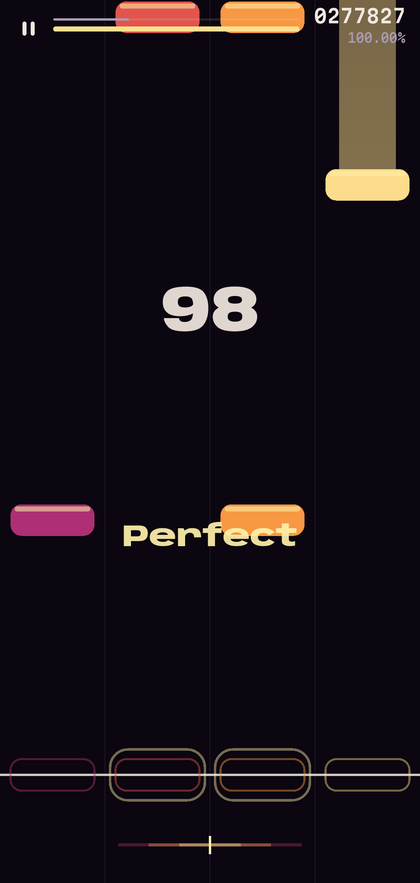
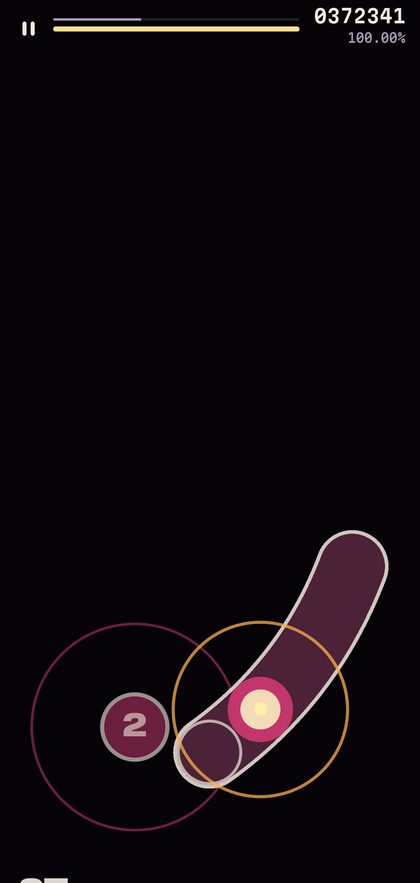
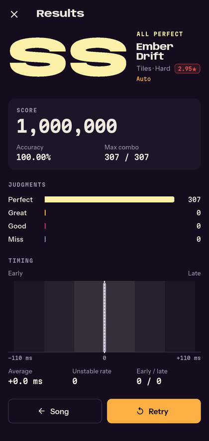
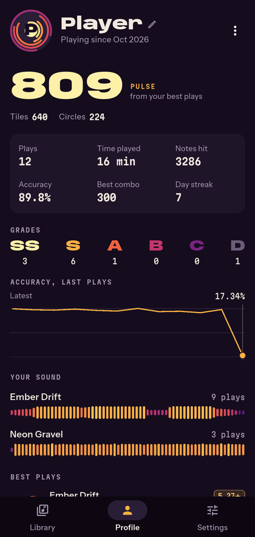
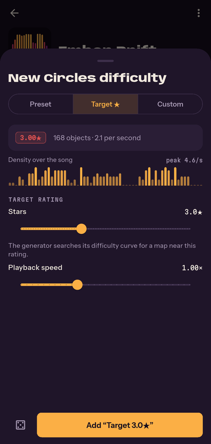
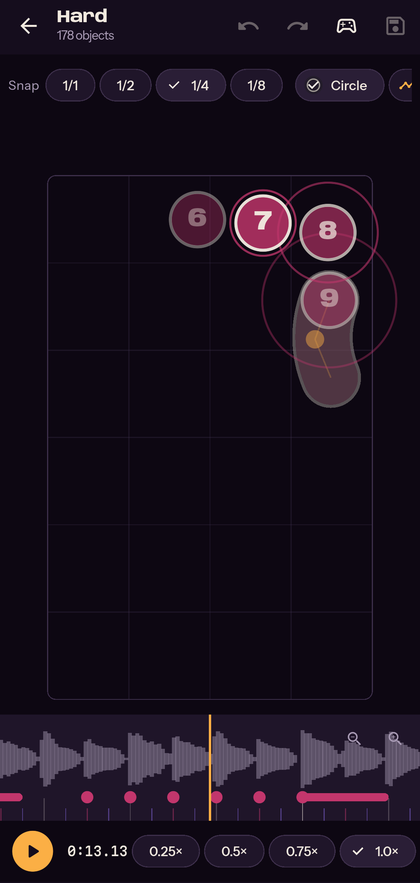

<div align="center">


# Rhytmaniac

**A portrait rhythm game that maps your own music.**
Import any MP4, MP3, M4A or WAV from your phone — Rhytmaniac finds the beat and
builds playable maps from about 1★ to 5★+, for two game modes.


</div>

<table>
  <tr>
    <td></td>
    <td></td>
    <td></td>
    <td></td>
  </tr>
  <tr>
    <td align="center">Library</td>
    <td align="center">Difficulties</td>
    <td align="center">Tiles</td>
    <td align="center">Circles</td>
  </tr>
  <tr>
    <td></td>
    <td></td>
    <td></td>
    <td></td>
  </tr>
  <tr>
    <td align="center">Results</td>
    <td align="center">Profile</td>
    <td align="center">Generator</td>
    <td align="center">Editor</td>
  </tr>
</table>

## Contents

- [Features](#features)
- [Install](#install)
- [How it works](#how-it-works)
- [Tech stack](#tech-stack)
- [Development setup](#development-setup)
- [Project structure](#project-structure)
- [Releases and versioning](#releases-and-versioning)
- [Release signing](#release-signing)
- [Data formats](#data-formats)
- [Contributing](#contributing)
- [Known limitations](#known-limitations)
- [License and credits](#license-and-credits)

## Features

**Bring your own music**
- Import video or audio through the system file picker. Title, artist and cover art
  (embedded art or a frame from the video) are read automatically and can be edited.
- Audio is decoded on-device and analyzed in the background: onsets, tempo and beat
  grid (including tempo changes and triplet or swing parts), downbeats, loudness,
  sustained notes, quiet breaks and loud "kiai" sections.
- A beat-analysis view shows the waveform, beat grid, tempo sections and detected
  onsets, with playback, so you can check what the app heard.

**Play osu! beatmaps**
- Import an osu! beatmap set (`.osz`): osu!standard difficulties become Circles maps
  (sliders of every curve type, repeats, ticks, slider velocity, spinners, combo
  colours, kiai), osu!mania difficulties (1K–10K, holds) become Tiles maps. Circle
  size, approach rate, timing windows and HP carry over; the background becomes the
  cover. The song also gets Rhytmaniac's own generated difficulties.
- The landscape osu! playfield is turned a quarter turn to fill the portrait screen,
  which keeps every pattern's shape and spacing.

**Two game modes, generated for every song**
- **Tiles**: 3–6 lanes, taps and holds (release timing counts). Lanes follow pitch;
  chords, trills and jacks scale with difficulty.
- **Circles**: hit circles with approach rings, follow points, sliders with ticks and
  reverse arrows, and spinners (with RPM and bonus spins) in a tall portrait
  playfield, with flowing patterns, combo colours, hit lighting and a touch trail.
- Easy → Expert presets, a **Target ★** mode that searches for a map near the rating
  you ask for, and a **Custom** mode with every knob: density, snap, hit window,
  scroll speed / approach time, lanes / circle size, chords, jacks, spacing, holds,
  sliders, spinners and playback speed.
- Star ratings are computed from the generated map with a strain model, and change
  with playback speed.

**Play**
- The audio output drives timing: the game clock follows the real playback position
  of the music; per-song and global offsets, plus a tap-along calibration screen.
- osu!-style mods with score multipliers: Easy, No-Fail, Half Time / Double Time (any
  speed 0.5×–2.0×), Nightcore, Hard Rock, Hidden, Flashlight, Sudden Death, Perfect,
  Mirror and Autoplay.
- osu!-style score with no fixed maximum: each hit is worth 300 / 100 / 50 plus a
  combo bonus that grows with the combo, the map's difficulty and the mods, so long
  and hard maps score far higher than short easy ones.
- Health with passive drain (each map's HP setting), combo, accuracy, grades SS–D,
  break banners, kiai pulses on the beat, hit sounds, haptics, pause with countdown.
  The playfield sits on plain black so nothing distracts from the notes. Music
  pauses whenever the app leaves the screen.
- Results with judgment breakdown, a health and accuracy graph, slider ticks and
  spinner bonus, and an early/late hit-error histogram that can correct the song's
  offset for you.
- Replays: every finished run is recorded; watch it from the results or from the
  local ranking of each difficulty.
- Practice mode loops any section, slowed down if you like.

**Make it yours**
- Editor: zoomable timeline with waveform and beat grid, snap divisors, slowed
  playback, place/drag/delete notes, draw holds and sliders, undo/redo, regenerate a
  section, test-play from any point. Edits are saved as separate difficulties.
- Library sorting and search, a local ranking per difficulty, song previews on the
  song page, and a profile with your Pulse rating, best plays, most played songs and
  accuracy trend.
- Share songs as zip packs; move your whole profile (scores, settings, optionally
  your library) to another device. Exports go to `Download/Rhytmaniac` or any folder
  you choose.

## Install

1. Open the [latest release](../../releases/latest) on your phone.
2. Download `Rhytmaniac-vX.Y.apk` (works on every device) — or the smaller
   `arm64-v8a` build for most phones from 2017 onward.
3. Open the file and allow installs from your browser or file manager when asked.

New releases install over old ones and keep your library and scores. Requires
Android 7.0 or newer.

## How it works

```
 media file ──► MediaExtractor + MediaCodec ──► mono PCM 22.05 kHz
                                                       │  (background isolate)
                                                       ▼
   STFT 1024/256 ─► band spectral flux ─► adaptive peak picking ─► onsets
         │                                                           │
         ├─► autocorrelation + comb search ─► BPM, beat grid, downbeat
         └─► RMS / band energy ─► loudness curves, breaks, sustained notes
                                                       │
                 analysis.json  ◄──────────────────────┘
                       │
   generator (seeded) ─┼─► Tiles: grid snap, density, lanes by pitch, holds
                       └─► Circles: distance snapping, flow, sliders, spinners
                                   │
                         strain-based star rating
```

- **Timing**: the music plays through one ExoPlayer instance in a small Kotlin
  bridge. The game polls its output position (derived from AudioTrack timestamps)
  about ten times a second and dates each report at the middle of the round trip; a
  monotonic clock extrapolates between reports, each report nudges it back, and large
  jumps snap. Audio stalls or speed changes therefore can't make notes drift from the
  music. Judgments use real milliseconds, so speed mods keep the windows fair.
- **Tempo sections**: 12 s windows each get a local tempo; two agreeing windows away
  from the current tempo start a new section, whose boundary is then moved to where
  the old grid stops and the new one starts explaining the onsets. Off-beat onsets
  vote window by window for a 1/4 or 1/3 grid to find triplet and swing parts.
- **Generation** is deterministic per seed and only reads the cached analysis, so a
  new difficulty takes well under a second.
- **Score** follows osu!'s classic formula: a hit adds its points plus
  `points × (combo − 1) × difficulty × mods ÷ 25`, where the difficulty multiplier
  (1–6) comes from HP, circle size (lane count in Tiles), timing strictness and note
  density. Slider ticks add 10, repeats 30, bonus spinner spins 1,000.
- **Star rating** collects decaying per-object strain (Tiles: per-lane, overall and
  hold strain; Circles: aim and speed, scaled to circle size) in 400 ms sections and
  sums the sorted peaks with geometric weights. Presets are calibrated to land near
  1, 2, 3, 4 and 5★ on varied test songs.

## Tech stack

| Area | Choice | Why |
|---|---|---|
| App | Flutter 3.47 / Dart 3.13 | Fast iteration and smooth custom drawing on Android. |
| Rendering | `CustomPainter` + `Ticker` | Two 2D playfields don't need a game engine; raw pointer events give lag-free multi-touch. |
| Audio decoding | Android `MediaExtractor` / `MediaCodec` (Kotlin) | Built in and hardware-accelerated; no 30–60 MB ffmpeg build or licence baggage. |
| Analysis | Pure Dart + [`fftea`](https://pub.dev/packages/fftea), run in an isolate | Testable on the desktop, never blocks the UI. |
| Music / effects | ExoPlayer ([`media3`](https://developer.android.com/media/media3)) and SoundPool, behind a small Kotlin bridge (`GameAudio.kt`) | Real output position for the game clock, pitch-preserving or Nightcore speed, music that pauses with the app; low-latency hit sounds that never steal audio focus. |
| Storage | [`sembast`](https://pub.dev/packages/sembast) + JSON files per song | No code generation; records match the export formats. |
| State | [`flutter_riverpod`](https://pub.dev/packages/flutter_riverpod) | Simple dependency injection and testable notifiers. |
| Sharing | [`archive`](https://pub.dev/packages/archive), Storage Access Framework, MediaStore | Zip packs saved to Downloads or any folder. |

## Development setup

### Prerequisites

| Tool | Version |
|---|---|
| [Flutter](https://docs.flutter.dev/get-started/install) | 3.47 (stable), with Dart 3.13 |
| Android SDK | Platform 36+, build-tools 36 (install through Android Studio) |
| JDK | 17 or newer (the one bundled with Android Studio works) |
| Python 3 + NumPy + Pillow | Only to regenerate bundled audio or icons |

Run `flutter doctor` and accept the Android licences (`flutter doctor --android-licenses`).

### Get the code running

```sh
git clone <this repository> rhytmaniac
cd rhytmaniac
flutter pub get
flutter run                      # debug build on a connected phone or emulator
flutter run --release            # smooth gameplay; signs with the debug key unless key.properties exists
```

On first launch the app installs *Ember Drift*, an original demo song synthesized
by `tool/synth_assets.py`, so you can play immediately.

### Everyday commands

```sh
flutter analyze                  # must report no issues
flutter test                     # unit and widget tests, run on the desktop VM
flutter build apk --release      # universal APK in build/app/outputs/flutter-apk/
python tool/synth_assets.py      # regenerate the demo song and hit sounds
python tool/make_icons.py        # regenerate launcher icons
```

### Useful in-app tools

- **Settings → FPS counter** shows frame rate, audio-clock drift and UI/raster
  cost per frame during play.
- **Song menu → Beat analysis** visualizes what the analyzer detected.
- **Mods → Autoplay** plays any map perfectly, handy for checking generated maps.

## Project structure

```
lib/
├── core/                 Pure Dart (no Flutter): runs in isolates and unit tests
│   ├── analysis/         STFT, spectral flux, peak picking, tempo and beat grid
│   ├── generator/        Note selection, Tiles lanes, Circles placement
│   ├── import/           osu! beatmap parser and converter
│   ├── rating/           Strain-based star rating
│   ├── scoring/          Judgments, score, accuracy, health
│   ├── gameplay/         Tiles and Circles rules, autoplay
│   ├── timing/           Audio-driven song clock, offset calibration
│   └── models/           Versioned JSON models
├── data/                 Library database, song folders, import pipeline, zip packs
├── platform/             Dart side of the Android bridge
├── audio/                Dart side of the native music player, hit sounds
├── game/                 Gameplay renderers, HUD and effects
└── ui/                   Screens, editor, theme (design tokens in theme.dart)
android/app/src/main/kotlin/…/
├── MainActivity.kt       File picking and saving (SAF, MediaStore)
├── GameAudio.kt          Music (ExoPlayer) and hit sounds (SoundPool)
└── MediaTools.kt         MediaCodec decoding, tags and cover extraction
test/                     core/ (logic), data/ (database and packs)
tool/                     Asset synthesizer and icon generator
.github/                  CI and release workflows, version script
```

## Releases and versioning

Every push to `main` runs [`.github/workflows/release.yml`](.github/workflows/release.yml):

1. Analyze and test.
2. Compute the next version from existing tags with
   [`.github/scripts/next-version.sh`](.github/scripts/next-version.sh): the major
   number comes from `pubspec.yaml`, the minor number is one higher than the last
   `vX.Y` tag. Releases go `v1.0`, `v1.1`, `v1.2`, … and a version is never reused,
   so no release is ever overwritten.
3. Build signed APKs with that version name and a build number equal to the commit
   count on `main` (so each release installs over the previous one).
4. Publish a GitHub release titled **Rhytmaniac vX.Y** with the universal APK, the
   per-ABI APKs, generated release notes and the signing certificate fingerprint.

| To… | Do this |
|---|---|
| Start a new major series (`v2.0`, `v2.1`, …) | Change `version:` in `pubspec.yaml` to `2.0.0+1` and push. |
| Push to `main` without releasing | Put `[skip release]` in the commit message. |
| Re-run a release manually | Actions → Release → *Run workflow*. |

Pull requests and other branches run [`.github/workflows/ci.yml`](.github/workflows/ci.yml)
(analyze, test, Android build).

## Release signing

Android only installs an update if it is signed with the **same key** as the
installed app. The release key lives in two files at the project root, both
**gitignored and never committed**:

| File | Contents |
|---|---|
| `rhytmaniac-release.jks` | The keystore (RSA 4096, valid 100 years, alias `rhytmaniac`). |
| `key.properties` | Keystore path, alias and passwords, read by `android/app/build.gradle.kts`. |

Release certificate SHA-256 (public; use it to verify downloads):
`C3:16:48:F3:64:FA:B8:2F:60:60:BE:90:38:24:CC:39:DA:01:43:19:DB:83:C1:D0:52:49:47:72:2C:63:2F:48`

> **Back both files up now** (password manager, encrypted drive or private cloud
> storage). If the key is lost, existing installs can't be updated: everyone would
> have to uninstall and lose their local data.

### Use the key on another machine

1. Clone the repository and run `flutter pub get`.
2. Copy `rhytmaniac-release.jks` and `key.properties` from your backup into the
   project root (next to `pubspec.yaml`).
3. Check it is picked up:
   ```sh
   flutter build apk --release
   # Windows:
   %LOCALAPPDATA%\Android\Sdk\build-tools\36.0.0\apksigner.bat verify --print-certs build\app\outputs\flutter-apk\app-release.apk
   # macOS / Linux:
   $ANDROID_HOME/build-tools/36.0.0/apksigner verify --print-certs build/app/outputs/flutter-apk/app-release.apk
   ```
   The `SHA-256 digest` must match the fingerprint above. Without `key.properties`
   the build falls back to the debug key and prints a warning.

### Give the key to GitHub Actions (one time per repository)

Add four repository secrets under **Settings → Secrets and variables → Actions**
(values come from `key.properties`):

| Secret | Value |
|---|---|
| `ANDROID_KEYSTORE_BASE64` | The `.jks` file, base64-encoded (commands below) |
| `ANDROID_KEYSTORE_PASSWORD` | `storePassword` |
| `ANDROID_KEY_ALIAS` | `keyAlias` (`rhytmaniac`) |
| `ANDROID_KEY_PASSWORD` | `keyPassword` |

With the [GitHub CLI](https://cli.github.com/) from the project root:

```powershell
# Windows PowerShell
gh secret set ANDROID_KEYSTORE_BASE64 --body ([Convert]::ToBase64String([IO.File]::ReadAllBytes("rhytmaniac-release.jks")))
gh secret set ANDROID_KEYSTORE_PASSWORD   # paste storePassword when prompted
gh secret set ANDROID_KEY_ALIAS --body rhytmaniac
gh secret set ANDROID_KEY_PASSWORD        # paste keyPassword when prompted
```

```sh
# macOS / Linux
base64 < rhytmaniac-release.jks | tr -d '\n' | gh secret set ANDROID_KEYSTORE_BASE64
gh secret set ANDROID_KEYSTORE_PASSWORD
gh secret set ANDROID_KEY_ALIAS --body rhytmaniac
gh secret set ANDROID_KEY_PASSWORD
```

Until the secrets exist, the release workflow still analyzes and tests but skips
publishing, with a warning in the run summary.

### Forks

Forks can't (and shouldn't) use this key. To publish your own builds, create a key
and point `key.properties` at it:

```sh
keytool -genkeypair -v -keystore rhytmaniac-release.jks -storetype PKCS12 \
  -keyalg RSA -keysize 4096 -validity 36500 -alias rhytmaniac
```

Remember to change `applicationId` in `android/app/build.gradle.kts` so your build
can live next to the official app.

## Data formats

All files are JSON with a `formatVersion` field; readers stay backward compatible.

| File | Contents |
|---|---|
| `analysis.json` (v2) | `bpm`, `beatOffsetMs`, `beatLengthMs`, `barOffsetBeats`, `timingPoints`? (`timeMs`, `beatLengthMs`, `meter`, `barOffsetBeats`, `triplet`), onsets (`timeMs`, `strength`, `low`/`mid`/`high`), energy curves, sustains, waveform peaks |
| `beatmap.json` (v2) | `mode`, metadata, difficulty parameters (incl. `hpDrain`), `seed`, `starRating`, `edited`, `timing`?, `kiai`? (`[start, end]` pairs), `origin`? (`"osu"`), `objects` |
| Tiles object | `{ "type": "tap" \| "hold", "timeMs", "lane", "endTimeMs"? }` |
| Circles object | `{ "type": "circle" \| "slider" \| "spinner", "timeMs", "x", "y", "comboIndex", "path"?, "curve"? (`"linear"` for sampled paths), "repeats"?, "tickMs"?, "endTimeMs"? }` — coordinates normalized to 0–1 on a fixed-aspect playfield |
| Score (v3) | judgments, accuracy, score (osu!-style, no cap; scores saved before v3 were out of 1,000,000), max combo, mods, grade, mean error, unstable rate, timestamp, song audio hash, `hasReplay` |
| Replay `replays/<scoreId>.json.gz` | `scoreId`, `beatmapId`, `mode`, `mods`, `player`, `frames` (flat `[timeMs, action, pointer or lane, x, y, …]`) |
| Song pack `*.rhpack.zip` | `manifest.json` + `songs/<id>/{source.*, cover.jpg, analysis.json, maps/*.json}` |
| Profile `*.rhprofile.zip` | `manifest.json` + `profile.json` (player, settings, scores, play stats), optionally the full library; scores re-link to songs by audio hash |

## Contributing

1. Fork or branch from `main` (`feature/short-name`, `fix/short-name`).
2. Make the change with tests for any logic in `lib/core/` or `lib/data/`.
3. Run `flutter analyze` (no issues) and `flutter test` (all green).
4. Open a pull request describing what changed and how you checked it; include a
   screenshot or screen recording for UI changes. CI must pass.

Guidelines:
- Keep `lib/core/` free of Flutter imports so it stays testable and isolate-safe.
- Use the design tokens in `lib/ui/theme.dart`; the heat ramp is reserved for data
  (fingerprints, stars, lanes, judgments).
- Changes to the generator or rating must keep the preset ladder calibrated
  (`test/core/generator_test.dart`).
- Changing a stored format means bumping its `formatVersion` and keeping old files
  readable.

## Known limitations

- Tempo detection handles up to eight steady tempo sections and triplet or swing
  parts; music that speeds up and slows down freely (rubato, live recordings
  without a click) is followed only approximately.
- Onset detection is heuristic; tune generated maps with Custom or the editor.
- osu! imports: osu!taiko and osu!catch difficulties are skipped; storyboards,
  custom hit sounds and skins aren't used; the playfield is rotated to portrait.
- Android only.

## License and credits

No open-source license has been chosen yet, so all rights are reserved by the
author until one is added.

- Fonts: [Anybody](https://github.com/Etcetera-Type-Co/Anybody),
  [Instrument Sans](https://github.com/Instrument/instrument-sans) and
  [Martian Mono](https://github.com/evilmartians/mono), under the SIL Open Font
  License (copies in `assets/fonts/`).
- The demo song and all sound effects are original, synthesized by
  `tool/synth_assets.py`.
